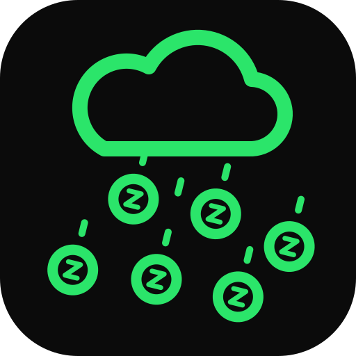

# zvm-rain



Rain for Telegram on the ZVM: `/rain 100` in a group splits 100 ZNN evenly
between everyone who spoke there in the last minute. Any ERC-20 works the same
way (`/rain 50 wqsr`), and the window can be up to an hour (`/rain 100 5`).

Only people who linked a wallet and spoke in that group in that window are
paid. A sender approves Rain for an amount of a token; nothing is deposited.

- `contracts/`: `Rain.sol` and its build script
- `cmd/zvm-rain`: `keys`, `deploy`, `check` and `bot`
- `web/`: the page where a wallet signs the link and the approvals
- `deployments/zvm.json`: what a deploy wrote; kept out of git, as every devnet deploys its own

## Run

```sh
cd contracts && npm install && npm run build
go test ./...
cp .env.example .env              # the Telegram token, RPC, known tokens
docker compose up -d --build      # the bot, and the page on 127.0.0.1:47611
```

The bot sees group messages only with privacy mode off (@BotFather,
`/setprivacy`) or as an admin. `.env` and `secrets/` stay out of git and out of
the image.

## Deploy the page

Every push to `main` publishes `web/` to GitHub Pages (Settings, Pages, Source:
GitHub Actions), reading the chain through the organisation's `ZVM_NODE` Actions variable.

No node is built in: the bot and the deploy commands read `ZVM_RPC` (and
`ZVM_NODE` to verify), the page `VITE_*`. `.env.example` has
a local [zvm-devnet](https://github.com/Zenoglyphs-VM/zvm-devnet)'s.

MIT licence. The full guide, with how it works and why: [docs/GUIDE.md](docs/GUIDE.md).
