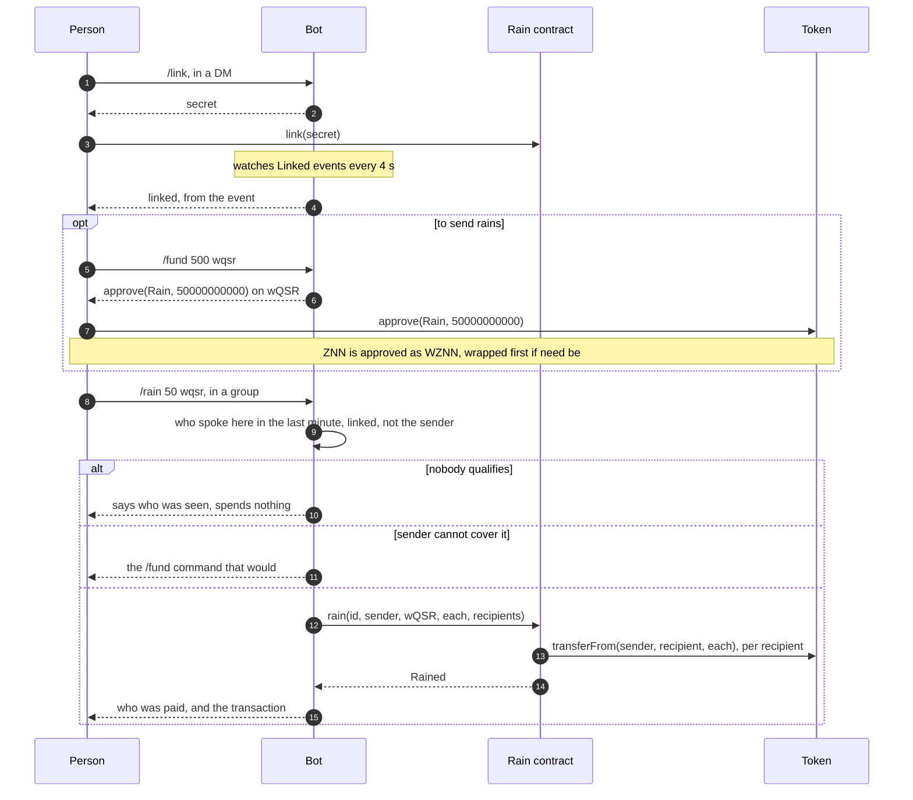

# zvm-rain guide


Rain for Telegram on the ZVM: `/rain 100` in a group splits 100 ZNN evenly
between everyone who spoke there in the last minute. Any ERC-20 works the same
way (`/rain 50 wqsr`, `/rain 10 bullet`, `/rain 5 0x…`), and the window is
anything up to an hour (`/rain 100 5`).

- `contracts/`: `Rain.sol`, and the script that builds it
- `cmd/zvm-rain`: `keys`, `deploy`, `check` and `bot`
- `web/`: the page at a ZVM gateway's `/rain/`, where a wallet signs
  the link and the approvals the bot prepares
- `deployments/zvm.json`: what a deploy wrote; kept out of git, as every devnet deploys its own

| | First deployment (chain 7340469) |
|---|---|
| Rain | `0x3b5e249421bb4E2E74B7A2B6EeEdc484DE50501A` |
| WZNN, which ZNN rains draw on | `0x91f5dda8243e34697c99be282e05bf48e35a0115` |
| Bot, the contract's operator | `0xDa6bcCb97df49cB924Cb9468a5f33828dA0b9daE` |

The contract is verified on the explorer with an exact match.
The first deployment's first Rain held ZNN deposits; it was
replaced before anyone linked to it, when deposits gave way to approvals.

## Who gets paid

Only people who spoke **in the group the rain was called in**, in the window it
names, who have linked a wallet, who are not the sender. The bot keeps, per
group, when each person last spoke; nothing about one group reaches a rain in
another. A rain pays at most `RAIN_MAX_RECIPIENTS` people (50), the most recent
speakers first.

When nobody qualifies the bot says which of the two it is (nobody spoke, or
nobody who spoke has linked), names the people it saw so they can `/link`,
and spends nothing. The split is exact to the base unit; what does not divide
evenly stays with the sender.

The bot sees ordinary group messages only with privacy mode off (@BotFather,
`/setprivacy`, Disable) or as a group admin. With privacy mode on it sees only
commands, and a rain finds nobody; the bot warns in its log at startup.

## Linking, and what a sender allows



The bot's `/link`, `/fund` and `/revoke` replies lead with a link to the page
with the work filled in (`?link=<secret>`, `?token=wqsr&amount=500`,
`&revoke=1`), and a MetaMask app link for phones, where Telegram's browser has
no wallet. The page connects the wallet, switches it to chain 69, and sends the
one call each needs for the wallet to sign; for ZNN it wraps what the wallet
lacks first. The explorer steps follow in the same reply, for doing it by
hand. A contract cannot approve on someone's behalf (an ERC-20 approval is
always from `msg.sender`), and of the named tokens only BULLET has `permit`,
so a wallet-signed `approve` on each token is the one general way.

The page's background is green rain falling, drawn on a canvas. It always
moves; the OS reduced-motion setting does not stop it (see the root
`CLAUDE.md`).

Recipients only link. Senders approve Rain, one token and one amount at a time,
and nothing is deposited: what they hold stays in their wallet until a rain
spends it, and nothing they did not approve is reachable.

- **Any ERC-20** is approved on that token alone: `approve(Rain, amount)`.
  `/fund 500 wqsr` replies with the exact call, the amount already in base
  units; `/revoke wqsr` with the call that sets it to zero.
- **ZNN** is the chain's coin and has no `approve`, so it is approved as WZNN
  (wrapped ZNN, 1:1). A ZNN rain pulls the WZNN, unwraps it, and pays
  recipients plain ZNN. `/fund 100` reads the linked wallet and, when it holds
  less than 100 WZNN, first says how much ZNN to wrap (WZNN's `deposit`, the
  amount typed in its Value field as whole ZNN), then gives the `approve`.

`/wallet` shows each token's approval and balance, and flags an unlimited
approval.

When a rain is short, the bot answers with the one command that would cover
it, for example `/fund 50 wqsr`.

If the watcher sees a second address send the same secret, the first link
stands and the person is told; sending the bot the hash of their own
transaction settles it, since only they can send it from their chat.

## The contract

The operator (the bot's key) chooses the recipients, so it is trusted with what
senders approve, as Bullet Game's escrow owner is trusted with
stakes. What the contract refuses whatever the operator asks:

- a sender who has not linked, or has since called `unlink()`, which is a
  kill switch for everything the bot could spend;
- a recipient who has not linked, or the sender among the recipients;
- the same recipient twice (the list must be strictly ascending);
- the same rain id twice. The bot numbers each rain in its database before
  sending it, so a resend after a lost receipt pays nothing;
- more than 100 recipients, or more of a token than the sender approved;
- ZNN sent to it directly: only WZNN, unwrapping, may pay it ZNN, so nothing
  can be stranded there.

A ZNN payment is pushed with 30,000 gas; a recipient that refuses it (a
contract with no `receive`) is paid its share in WZNN instead, and the rest of
the rain goes through. Tokens that return nothing from `transferFrom`, as USDT
does, are accepted.

`contracts/scripts/build.mjs` compiles with solc 0.8.19 for paris, the
combination Bullet Game's contracts already run on the ZVM.

## Running it

```sh
cd contracts && npm install && npm run build
go test ./...
zvm-rain keys -out secrets/rain.json          # refuses to overwrite
zvm-rain deploy -keys secrets/rain.json -record deployments/zvm.json -wznn 0x…
zvm-rain check -record deployments/zvm.json
```

`deploy` tops the bot up to 50 ZNN of gas from the devnet wallet (zvm's dev EVM
key 900), deploys Rain with the bot as operator and WZNN (`-wznn`), reads it back and verifies it
on the explorer. Each step checks the chain first, so a stopped deploy is
finished by running it again.

Rain deploys on its own, from this directory. `docker-compose.yml` runs two
services:

- `bot`: the Telegram bot. It reaches chain 69 through the JSON-RPC `.env` names
  (`ZVM_RPC`; no node is built in) and publishes no port.
- `web`: the page, built and served by Caddy on `127.0.0.1:47611`. The devnet's
  gateway forwards `/rain/*` to it and holds nothing else of Rain's. The image
  gets only what the page needs: `VITE_ZVM_NODE`, `VITE_GATEWAY`, `RAIN_TOKENS`
  and `RAIN_BOT_USERNAME`. Every setting is in
`.env` (copy `.env.example`): the Telegram token, an optional group
allow-list (empty means any group), the RPC, the tokens known by name, the
window and the recipient cap. `secrets/rain.json` is the operator key.
`.env` and `secrets/` are kept out of git and out of the image.

```sh
docker compose up -d --build     # after any change to .env or the code
docker compose logs -f bot
```

A change to `.env` needs `up -d`, not `docker restart`. The bot keeps who spoke
when in memory only, so after a restart a rain covers only who has spoken
since. A rain the bot stopped in the middle of is settled at startup from the
contract's `rained(id)`, never resent.

The live test deploys a fresh Rain and runs every rule above through the bot's
own chain code. It spends devnet ZNN, so run it against an anvil fork of chain
69 first:

```sh
docker run -d -p 127.0.0.1:48646:8545 --add-host=host.docker.internal:host-gateway \
  ghcr.io/foundry-rs/foundry:latest \
  "anvil --host 0.0.0.0 --fork-url $ZVM_RPC --chain-id 7340469 --block-time 1"
RAIN_LIVE_RPC=http://127.0.0.1:48646 go test ./internal/rain -run Live -v
```
